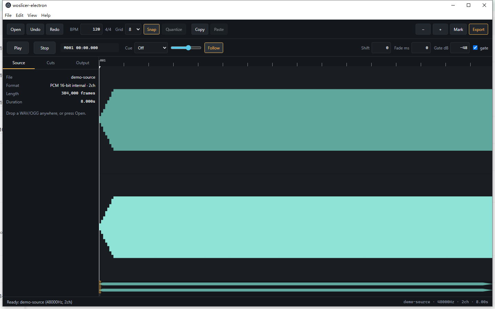

# woslicer-dx

[English](README.md) · [中文](README.zh-CN.md) · **日本語** · [한국어](README.ko.md)

wosderge の woslicerIII をベースにした、BMS 向けのオフライン音声スライサー。

## 機能

- WAV と OGG の読み込み、WAV スライスの書き出し。
- `.wosdx` プロジェクトの保存と読み込み、旧形式 `.wos` 設定の入出力、BMSE クリップボードでのマーカー交換。
- スナップ、範囲選択、クオンタイズ、元に戻す／やり直しを備えたタイムライン編集。
- 再生速度を変えたモニタリング、キュー音、タップ補正。
- 周波数帯域の表示と自動カット検出。
- 内蔵 BMHelper：鍵盤音用 MIDI パートを録音シーケンスと WAVE 定義に分割し、切断位置をタイムラインへ適用。
- 英語・中国語・日本語・韓国語の UI。「About」にバージョン、コミット、ビルド日時を表示。

## 実行

Releases（プレリリース）または Actions の成果物から、ご利用のシステム向けパッケージをダウンロードします。

| プラットフォーム | 形式 | 使い方 |
| --- | --- | --- |
| Windows | .msi / -setup.exe | インストーラーを実行 |
| Linux | .deb / .AppImage | deb をインストール、または AppImage を実行 |
| Web | .zip | 展開して静的サイトとして配信 |

Windows x64 が主要なデスクトップ版です。ほかのアーキテクチャや Linux パッケージは利用可能な場合に提供します。本アプリはファイルをローカルで処理し、オフラインで動作します。

Web 版はブラウザーで直接動作します：[woslicer-dx app](https://woslicer-dx.pages.dev/) （インストール不要）。

## 操作

| キー | 動作 |
| --- | --- |
| Space | 再生 / 一時停止 |
| Enter / `,` / `.` | 再生ヘッドまたはカーソル位置にカットを追加 |
| Z | カーソル位置のカットを切り替え |
| 方向キー | グリッド / 小節単位で移動。Shift+左右で 1 tick |
| P / O | 現在 / 前のスライスを試聴 |
| Q / W | グリッド密度を下げる / 上げる |
| `[` / `]` | モニタリング速度を下げる / 上げる |
| Ctrl+C / X / V | 選択したマーカーをコピー / 切り取り / 貼り付け |
| Ctrl+Z / Ctrl+Shift+Z | 元に戻す / やり直す |
| M | すべてのスライスを書き出す |
| Ctrl+O / Ctrl+Shift+O / Ctrl+S | 音声を開く / `.wosdx` プロジェクトを開く / プロジェクトを保存 |
| T / Y | `.wos` 設定の読み込み / 書き出し |
| V / B | BMSE クリップボードへの書き込み / 読み込み |

左ドラッグでカットを描画、右ドラッグで消去、Shift/Ctrl+ドラッグで範囲選択、カットをドラッグすると選択範囲が移動します。Ctrl+ホイールでズーム、中ボタンドラッグでパン。Alt を押している間はスナップが無効になります。

## プロジェクト情報

[変更履歴](CHANGELOG.md) · [開発ガイド（英語）](docs/DEVELOPMENT.md)

## ライセンスとクレジット

オリジナルの woslicer II/III: **wosderge**。コントリビューターが権利を持つ部分は [MIT](LICENSE) です。原版由来の部分とサードパーティの依存関係はこの許諾に含まれません。範囲と帰属については [NOTICE](NOTICE) を参照してください。

内蔵 BMHelper は、**exclusion** が公開したソースコードをもとに、Be-Music Helper（beta 4′）の動作を再実装したものです。原版の README では、金銭が絡まないことと作者を明示することを条件に二次利用が許可されています。[オリジナルの BMHelper](https://excln.github.io/bmhelper.html) · [NOTICE](NOTICE)
