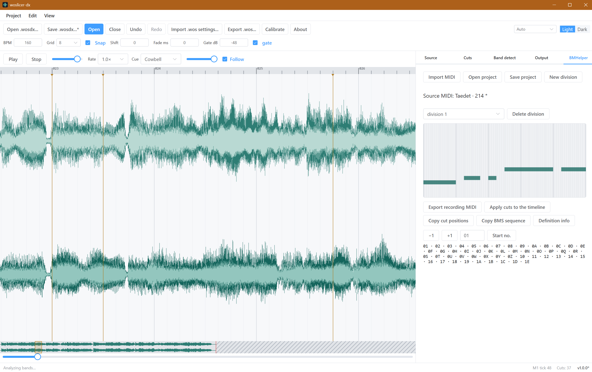

# woslicer-dx

[English](README.md) · [中文](README.zh-CN.md) · **日本語** · [한국어](README.ko.md)

wosderge の woslicerIII をベースにした、BMS 向けのオフライン音声スライサー。

## 機能

- WAV と OGG の読み込み、WAV スライスの書き出し。音源情報には元の形式を表示します。現在の音声処理と WAV 出力は 16-bit PCM です。
- `.wosdx` プロジェクトを保存し、再び開けます。旧形式 `.wos` の設定を読み込み、書き出せます。BMSE とはクリップボードで切断位置を交換できます。
- スナップ、範囲選択、クオンタイズ、元に戻す／やり直しを備えたタイムライン編集。
- 再生速度を変えたモニタリング、キュー音、タップ補正。
- 周波数帯域の表示と自動カット検出。
- 内蔵 BMHelper は、鍵盤音用 MIDI パートを録音シーケンスと WAVE 定義に分割します。その切断位置をタイムラインに適用できます。
- オリジナルの BMHelper beta 4′ の `.bmh` ファイルを読み書きできます。DX プロジェクトは Unicode の分割名を保持します。BMH 出力では原版の CP932 文字置換を適用し、名前が変わる場合は警告を表示します。
- 英語・中国語・日本語・韓国語の UI。「About」にバージョン、コミット、ビルド日時を表示。

## 実行

Releases（プレリリース）または Actions の成果物から、ご利用のシステム向けパッケージをダウンロードします。

| プラットフォーム | 形式 | 使い方 |
| --- | --- | --- |
| Windows | .zip | ZIP を展開して起動。WebView2 が必要 |
| Linux | .deb / .AppImage | deb をインストール、または AppImage を実行 |
| macOS | .dmg | ディスクイメージを開き、アプリを「アプリケーション」にドラッグ |
| Web | .zip | 展開して静的サイトとして配信 |

Windows x64 が主要なデスクトップ版です。ほかの Windows アーキテクチャ、Linux、macOS 向けのパッケージは利用可能な場合に提供します。本アプリはファイルをローカルで処理し、オフラインで動作します。

Web 版はブラウザーで直接動作します：[woslicer-dx app](https://woslicer-dx.pages.dev/) （インストール不要）。

## 操作

デスクトップ版のプロジェクトは音声の絶対パスを保存し、開くときに利用可能なファイルを自動で再接続します。ファイルを移動した場合は「音声を再リンク」を使ってください。ブラウザー版では手動での再リンクが必要です。セッションの復元中や音声の読み込み中は、作業領域の上部に現在の処理を表示します。

| キー | 動作 |
| --- | --- |
| Space | 再生 / 一時停止 |
| Enter / `,` / `.` | 再生ヘッドまたはカーソル位置にカットを追加 |
| Z | カーソル位置のカットを切り替え |
| 方向キー | グリッド / 小節単位で移動。Shift+左右で 1 tick |
| P / O | 現在 / 前のスライスを試聴 |
| Q / W | グリッド密度を下げる / 上げる |
| `[` / `]` | モニタリング速度を下げる / 上げる |
| Ctrl+C / X / V | 選択したマーカーをコピー / 切り取り / 貼り付け |
| Ctrl+Z / Ctrl+Shift+Z | 元に戻す / やり直す |
| M | すべてのスライスを書き出す |
| Ctrl+O / Ctrl+Shift+O / Ctrl+S | 音声を開く / `.wosdx` プロジェクトを開く / プロジェクトを保存 |
| T / Y | `.wos` 設定の読み込み / 書き出し |
| V / B | BMSE クリップボードへの書き込み / 読み込み |

- 左ボタンでドラッグすると切断位置を追加します。
- 右ボタンでドラッグすると切断位置を削除します。
- Shift または Ctrl を押しながらドラッグすると範囲を選択します。
- 切断位置をドラッグすると選択範囲を移動します。
- Ctrl+ホイールで拡大・縮小します。
- 中ボタンでドラッグすると表示範囲を移動します。
- Alt を押している間はスナップを無効にします。

## プロジェクト情報

[変更履歴](CHANGELOG.md) · [開発ガイド（英語）](docs/DEVELOPMENT.md)

## ライセンスとクレジット

オリジナルの woslicer II/III: **wosderge**。コントリビューターが権利を持つ部分は [MIT](LICENSE) です。原版由来の部分とサードパーティの依存関係はこの許諾に含まれません。範囲と帰属については [NOTICE](NOTICE) を参照してください。

内蔵 BMHelper は、**exclusion** が公開したソースコードをもとに、Be-Music Helper（beta 4′）の動作を再実装したものです。原版の README では、金銭が絡まないことと作者を明示することを条件に二次利用が許可されています。[オリジナルの BMHelper](https://excln.github.io/bmhelper.html) · [NOTICE](NOTICE)
