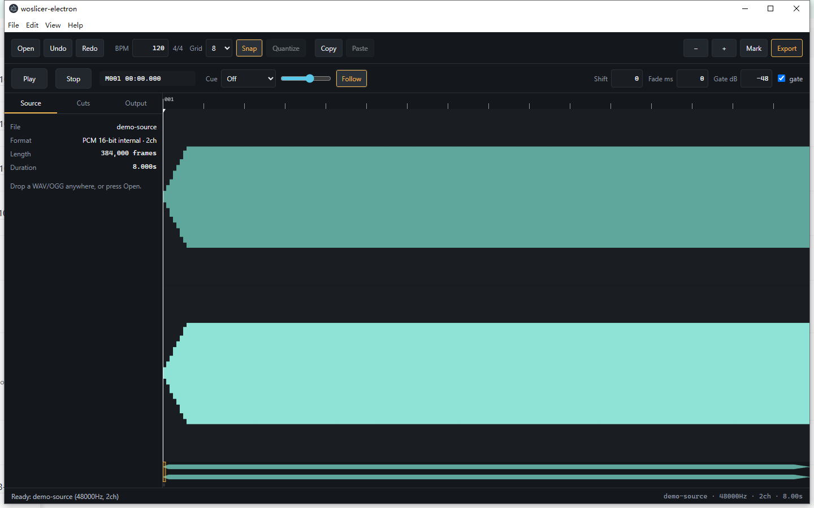

# woslicer-dx

[English](README.md) · [中文](README.zh-CN.md) · [日本語](README.ja.md) · **한국어**

wosderge의 woslicerIII를 기반으로 만든 BMS용 오프라인 오디오 슬라이서입니다.



## 기능

- WAV/OGG 가져오기, WAV 슬라이스 내보내기, `.wos` 프로젝트와 BMSE 클립보드 지원.
- 스냅, 범위 선택, 퀀타이즈, 실행 취소/다시 실행을 지원하는 타임라인 편집.
- 배속 모니터링, 큐 사운드, 탭 보정.
- 주파수 대역 표시와 자동 컷 감지.
- 내장 BMHelper: 건반음 MIDI 파트를 녹음 시퀀스와 WAVE 정의로 분할하고, 절단 위치를 타임라인에 적용합니다.
- 영어·중국어·일본어·한국어 UI. “About”에 버전, 커밋, 빌드 날짜를 표시.

## 실행

Releases(사전 릴리스) 또는 Actions 아티팩트에서 시스템에 맞는 패키지를 내려받습니다.

| 플랫폼 | 형식 | 사용 방법 |
| --- | --- | --- |
| Windows | .msi / -setup.exe | 설치 프로그램 실행 |
| Linux | .deb / .AppImage | deb 설치 또는 AppImage 실행 |
| Web | .zip | 압축을 풀고 정적 웹사이트로 호스팅 |

Windows x64가 기본 데스크톱 버전입니다. 다른 아키텍처와 Linux 패키지는 제공 가능한 경우 포함됩니다. 앱은 파일을 로컬에서 처리하며 오프라인으로 동작합니다.

웹 버전은 브라우저에서 직접 실행됩니다: [woslicer-dx app](https://woslicer-dx.pages.dev/) (설치 불필요).

소스에서 실행하려면 Node.js 26.x, npm, Git, Rust stable 툴체인이 필요합니다. Tauri 패키징에는 플랫폼별 도구(Linux는 WebKit/GTK, Windows는 WebView2)도 필요합니다.

```sh
npm ci
npm run dev
```

## 조작

| 키 | 동작 |
| --- | --- |
| Space | 재생 / 일시정지 |
| Enter / `,` / `.` | 재생 헤드 또는 커서 위치에 컷 추가 |
| Z | 커서 위치의 컷 전환 |
| 방향키 | 그리드 / 마디 단위로 이동. Shift+좌우는 1 tick |
| P / O | 현재 / 이전 슬라이스 미리 듣기 |
| Q / W | 그리드 밀도 줄이기 / 늘리기 |
| `[` / `]` | 모니터링 속도 낮추기 / 높이기 |
| Ctrl+C / X / V | 선택한 마커 복사 / 잘라내기 / 붙여넣기 |
| Ctrl+Z / Ctrl+Shift+Z | 실행 취소 / 다시 실행 |
| M | 모든 슬라이스 내보내기 |
| T / Y | `.wos` 저장 / 불러오기 |
| V / B | BMSE 클립보드 쓰기 / 읽기 |

왼쪽 드래그로 컷을 그리고, 오른쪽 드래그로 지우며, Shift/Ctrl+드래그로 범위를 선택하고, 컷을 드래그하면 선택 영역이 이동합니다. Ctrl+휠로 확대/축소, 가운데 버튼 드래그로 이동합니다. Alt를 누르는 동안에는 스냅이 해제됩니다.

## 개발

```sh
npm run lint
npm run fmt:check
npm run typecheck
npm test
npm run build
npm run test:app-ui
npm run package
```

로컬 빌드와 테스트는 기본적으로 debug를 사용합니다. release 빌드는 `npm run build -- --release` 또는 `npm run package -- --release`로 실행합니다. CI는 release만 사용합니다.

커밋 시 pre-commit 훅이 스테이지된 파일의 lint와 포맷 검사를 실행합니다.

오디오는 내부적으로 16-bit로 변환되며 내보내기는 16-bit PCM을 사용합니다. 원본 프로그램과의 비교 테스트에는 외부 픽스처가 필요하며, 없으면 건너뜁니다.

[CI](docs/CI.md), [버전 규칙](docs/VERSIONING.md), [변경 로그](CHANGELOG.md)를 참고하세요.

## 라이선스와 크레딧

원본 woslicer II/III: **wosderge**. 기여자가 권리를 가진 부분은 [MIT](LICENSE)이며, 원본에서 파생된 부분과 서드파티 의존성은 이 허여에 포함되지 않습니다. 범위와 저작자 표시는 [NOTICE](NOTICE)를 참고하세요.
