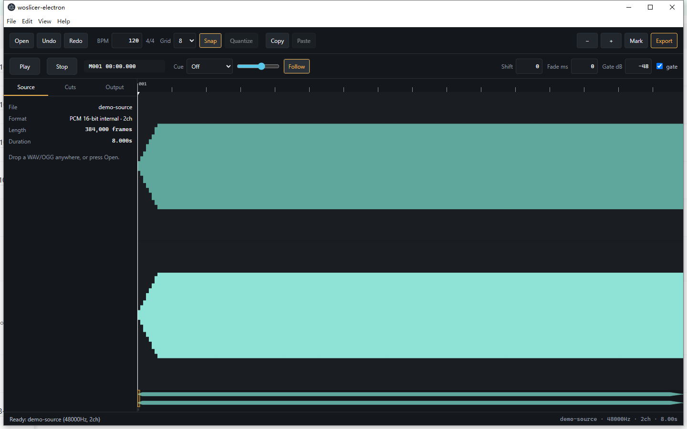
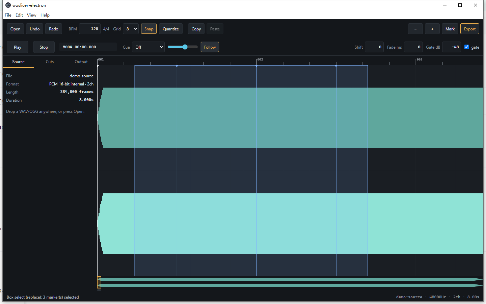
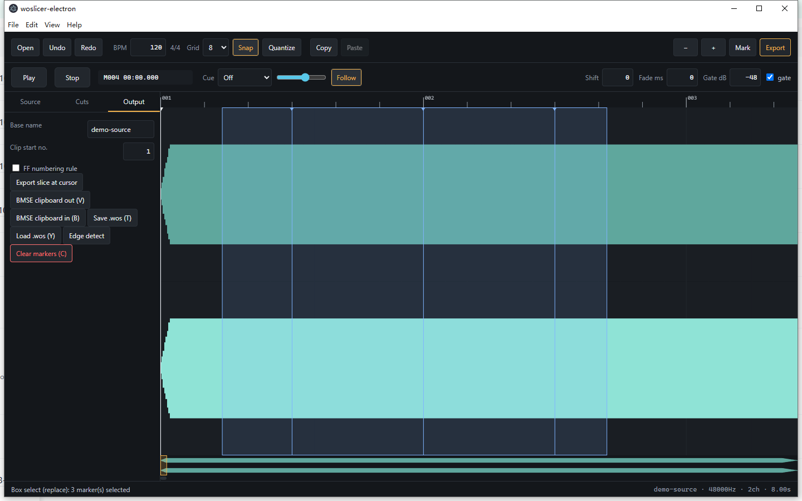

# woslicer-electron

An Electron + TypeScript reimplementation of **woslicerIII** (wosderge's BMS wav
slicer), aiming for byte-exact compatibility with the original `.wos` format and
slice rendering DSP.

The DSP, time base, `.wos` layout and BMSE clipboard format were recovered by
disassembling the original `woslicerIII.exe` (.NET IL) and verified against the
original program's own exported sample set (`../woslicerIII/new/KEY.wos` +
`KEY_000.wav` … `KEY_148.wav`): **the automated test suite re-renders all 149
oracle slices byte-identically** (see `tests/oracle.test.ts`).

## Screenshots

Horizontal DAW-style timeline with the L/R waveform, measure grid and
transport:



Box selection over multiple cut points (Shift adds, Ctrl toggles, drag moves
the whole group):



Output tab: slice naming, FF numbering rule, BMSE clipboard, `.wos`
save/load, edge detection:



## Requirements

- Node.js 22+ (built and tested on Node 24, Windows x64)
- npm (network access on first install)

Electron's binary download falls back to a mirror when GitHub is unreachable:

```sh
ELECTRON_MIRROR="https://npmmirror.com/mirrors/electron/" node node_modules/electron/install.js
```

## Commands

```sh
npm install            # dependencies (electron, typescript, ogg-vorbis wasm)
npm run typecheck      # strict TS check of both main and renderer configs
npm test               # build + unit tests (node:test) incl. the oracle test
npm run test:oracle    # only the byte-exact oracle verification
npm start              # build everything and launch the app
node scripts/smoke-gui.js   # end-to-end GUI smoke test (launches Electron)
```

`npm test` automatically picks up the repository's own oracle files when
`../woslicerIII/{KEY.wav,new}` exist; otherwise those specific tests are
skipped. All other tests use small deterministic in-memory fixtures.

## Product scope

- Strict woslicerIII compatibility: single BPM, single source / single track,
  horizontal DAW timeline, 192 ticks per measure, 49152 ticks total.
- Loads WAV (PCM 8/16/24/32-bit + IEEE float) and OGG Vorbis.
- Reads/writes `.wos` (exact 6168-byte layout), exports slice WAVs and the full
  slice set, reads/writes the `BMSE ClipBoard Object Data Format` clipboard.
- Playback / pause / stop / slice preview, Space "break point" while playing,
  box selection, multi-select drag, quantize, measure copy/paste, undo/redo.
- Cue monitor (off / cowbell / triangle / metronome), synthesized with Web
  Audio, monitor-only — never written into exports.

## Keyboard reference

Preserved from the original (semantics from readme/help + decompiled handlers):

| Key | Action |
| --- | --- |
| ← → | move cursor by grid step |
| ↑ ↓ | move cursor by measure |
| Z | place / remove cut line at cursor |
| P / Enter | preview slice at cursor |
| O | preview previous slice |
| Q / W | grid size down / up (4/6/8/12/16/24/32) |
| M | export all slices |
| V | BMSE clipboard out |
| B | BMSE clipboard in |
| A / S | output clip start number -1 / +1 |
| N | toggle FF numbering rule |
| T / Y | save / load `.wos` |
| C | clear all cut lines |
| 7 / 8 | shift all cut lines -1 / +1 tick |
| Ctrl+C / Ctrl+X / Ctrl+V | copy / cut / paste the SELECTED markers as a relative group |
| Ctrl+F | legacy alias: paste one measure of markers (original semantics, also in the Edit menu) |

The selection clipboard stores RELATIVE tick offsets (origin = smallest
selected tick). Pasting anchors the group origin at the cursor tick, preserves
relative spacing, rejects the whole group on out-of-range targets or collision
with foreign markers (idempotent re-paste at the clipboard origin is allowed),
and auto-selects the pasted markers. It is fully separate from the BMSE system
clipboard. Quantize acts ONLY on the selection; the Quantize button is
disabled without a selection. Multi-drag uses one shared clamped delta so
relative spacing can never break.

New additions (context-scoped, per spec):

| Key | Action |
| --- | --- |
| Space | playing: drop marker at playhead · stopped: play/pause (waveform focused) |
| Shift+← / → | cursor by single tick |
| Ctrl+V | paste (alias of the original Ctrl+F) |
| Ctrl+Z / Ctrl+Shift+Z / Ctrl+Y | undo / redo |
| Esc | clear selection |
| Ctrl+wheel / ruler wheel | zoom anchored at mouse tick |
| middle drag | pan |

Focus rules: inputs, selects and dialogs never trigger single-key actions;
Space on a focused button activates that button.

## Architecture

```
src/core/     pure modules (no Electron, fully unit-tested)
  wav.ts        RIFF chunk walker, PCM 8/16/24/32 + float decode, canonical writer
  ogg.ts        OGG Vorbis via @wasm-audio-decoders/ogg-vorbis (WASM)
  wos.ts        .wos read/write (6168 bytes, MSB-first bitmap, validation)
  timebase.ts   tick<->sample conversions (float64 export path, float32 view path)
  slicer.ts     woswrite/Cut/safe_data ports: fade-in, copy, sustain, gate, pad
  markers.ts    marker document: edit ops, quantize, measure clipboard, undo
  bmse.ts       BMSE clipboard format build/parse
  peaks.ts      hierarchical peak cache (drawing never rescans the file)
  edge.ts       RMS edge detection (original heuristic)
src/main/     Electron main process, IPC handlers, preload (contextBridge)
src/renderer  UI (no frameworks): canvas timeline, transport, cue synth, keys
tests/        node:test suites (see Test coverage)
docs/EXTRACTED_SPEC.md   the decompiled reference semantics
```

Security: `contextIsolation: true`, `nodeIntegration: false`, `sandbox: true`,
strict CSP, navigation/new-window blocked, preload exposes exactly 16
allowlisted functions (`tests/ipc-security.test.ts` asserts the surface).

## Verified behaviour (what the tests prove)

- `.wos`: fixed 6168 bytes, little-endian doubles/int32 header, MSB-first
  bitmap, full round-trip, truncated/corrupt input rejected, noisegate saved
  only as an integer (never silently truncated).
- Time base: BPM 120/185, positive/negative shift, EOF fallback, float32 view
  conversion vs float64 export conversion.
- DSP: fade-in envelope (integer-degree sine), 16-frame zero pad, Cut gate
  (threshold `32768/2^(dB/-6)`, Math.cos decay over 11025, `NULL` 4-frame
  collapse, dB=0 truncation), sustain tail with foldback + phase inversion,
  out-of-bounds reads return 0, canonical deterministic WAV header (including
  the original's `v >= 32678` guard, which is byte-transparent).
- **Oracle: all 149 original exported slices re-render byte-identical.**
- Markers: idempotent placement (Space de-dup), box select, multi-drag with
  merge/clamp, quantize with collision collapse, measure copy/cut/paste,
  undo/redo, whole-map shift.
- BMSE: exact format name, `101` + 8-digit tick + number lines, FF skip rule,
  internal clipboard isolation.
- WAV/OGG: chunk walking with JUNK/smpl/LIST, all bit depths, error paths.
- IPC: allowlist surface, path/request validation before IO.
- GUI smoke (`scripts/smoke-gui.js`): boots, loads a WAV via drag & drop,
  edits markers with the keyboard, round-trips BMSE/WOS, paints the waveform.

## Known limitations / deviations

- **24-bit output**: the original always exports 16-bit PCM and stores audio
  internally as int16; so does this project. 24-bit sources are converted
  lossily at load (top 16 bits), exactly like the original.
- **IEEE float WAV** decode is an extension; the original would have
  misinterpreted float files. 8/16/24-bit and 32-bit int PCM follow the
  original exactly.
- The original scanned for `fmt `/`data` bytes inside a 128-byte rolling
  buffer (crashing on large leading chunks). This implementation walks the
  RIFF chunk list instead — more robust, identical results for well-formed
  files. It also stops at the first `data` chunk, like the original.
- The original's auto "edge detection" ran on a low-resolution progress bar
  thread and is only approximately documented; `core/edge.ts` ports the RMS
  heuristic (window RMS ratio 1.5) but this is the one feature without an
  oracle to verify against.
- Preview playback uses the exact export DSP (like the original, which wrote
  `prev` and played it), but plays from memory via Web Audio instead of a
  temp file. The cue sounds are synthesized; the original had no cue feature.
- BMSE clipboard is written under the exact custom format name
  `BMSE ClipBoard Object Data Format` (Electron `ClipboardItem`, raw UTF-8
  bytes incl. trailing NUL) AND mirrored as `text/plain`, because the original
  BMSE reads the text format. Reading prefers the custom format and falls
  back to text.
- Export/save paths arrive from native dialogs; the renderer could send
  arbitrary strings, so IPC handlers shape-validate them (extension required,
  no `..` segments, no device namespaces, no control characters) and `.wos`
  saves are atomic (temp file + rename). Paths are not confined by opaque
  file IDs — a compromised renderer could still write a `.wav`/`.wos` to any
  user-writable path it can name; the dialog flow remains the trusted entry
  point.
- Export keeps the original's double-precision noisegate (`Cut(double dB,
  int msec)`); fractional dB is only rejected where the file format requires
  an integer (`.wos` save).
- OGG decoding uses a WASM Vorbis decoder instead of the original's
  `OggVorbis.dll`; the original's case-sensitive `.ogg` check is kept.
- `Math.sin`/`Math.cos` in the original resolved to the CRT (x87-era)
  implementations; the oracle test confirms V8's implementations agree on all
  149 slices, but a pathological future input within an ULP of a truncation
  boundary could theoretically differ by one quantization step.
- High-DPI: canvas drawing is device-pixel-ratio aware; the window geometry
  follows the frozen spec (1440x900 default, 960x600 minimum).

## Credits

woslicer II/III is by **wosderge** (ahiruworks, http://ahiruworks.com/). This
project is an independent reimplementation built from format/algorithm
analysis — no original binaries, source code or audio assets are included or
redistributed. The original's license permits non-commercial secondary use
with attribution and forbids distributing modified versions of the original;
please keep use of this tool non-commercial and keep this attribution.
