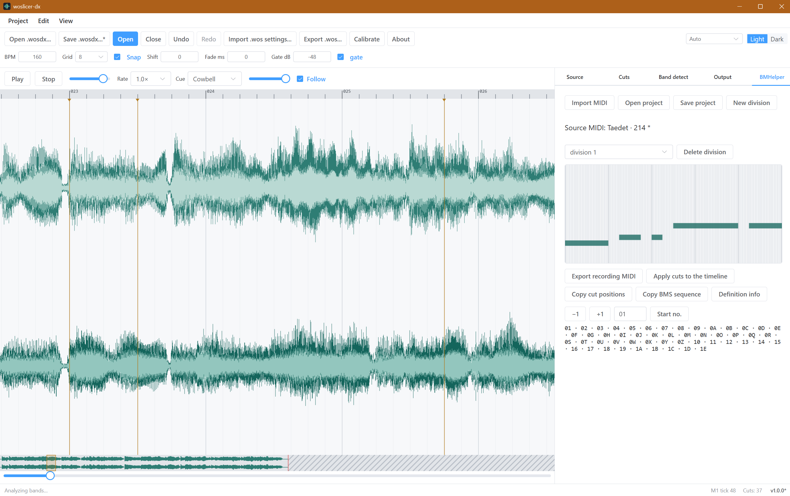

# woslicer-dx

[English](README.md) · **中文** · [日本語](README.ja.md) · [한국어](README.ko.md)

基于 wosderge 的 woslicerIII 开发的离线 BMS 音频切片工具。

> **[打开网页版](https://woslicer-dx.pages.dev/)** · 无需安装，音频在本机处理。

## 功能

- 导入 WAV 和 OGG，导出 WAV 切片。音源详情显示原始格式；当前音频处理和 WAV 输出使用 16-bit PCM。
- 保存和打开 `.wosdx` 工程，导入或导出旧版 `.wos` 设置，并通过剪贴板与 BMSE 交换切点。
- 时间轴编辑、吸附、框选、量化、撤销与重做。
- 变速监听、切点提示音和敲击校准。
- 频段显示与自动切点检测。
- 内置 BMHelper：将键音 MIDI 声部分割为录音序列与 WAVE 定义，并将切点位置应用到时间轴。
- 读写原版 BMHelper beta 4′ 的 `.bmh` 文件。DX 工程保留 Unicode 分割名称；导出 BMH 沿用原版 CP932 字符替换规则，名称变化时显示警告。
- 中、英、日、韩四种界面语言；“关于”显示版本、commit 和构建日期。

## 运行

从 Releases 或 Actions 附件下载对应系统的软件包：

| 平台 | 格式 | 使用方式 |
| --- | --- | --- |
| Windows | .zip | 解压后直接运行。需要已安装 WebView2 |
| Linux | .deb / .AppImage | 安装 deb 或运行 AppImage |
| macOS | .dmg | 打开磁盘映像，将应用拖入“应用程序” |
| Web | .zip | 解压后作为静态网站托管 |

Windows x64 为主要桌面版本。其他 Windows 架构、Linux 和 macOS 软件包在可用时提供。应用在本地处理文件，运行时无需联网。

## 操作

桌面版工程保存音频绝对路径，打开时自动关联可用文件。文件移动后，请使用“重新关联音频”。网页版需手动关联。恢复会话和加载音频时，工作区顶部显示当前阶段。

| 按键 | 功能 |
| --- | --- |
| Space | 播放 / 暂停 |
| Enter / `,` / `.` | 在播放头或光标处添加切点 |
| Z | 切换光标处的切点 |
| 方向键 | 按网格 / 小节移动；Shift+左右按单 tick 移动 |
| P / O | 预览当前 / 上一个切片 |
| Q / W | 减小 / 增大网格密度 |
| `[` / `]` | 降低 / 提高监听速度 |
| Ctrl+C / X / V | 复制 / 剪切 / 粘贴选中切点 |
| Ctrl+Z / Ctrl+Shift+Z | 撤销 / 重做 |
| M | 导出全部切片 |
| Ctrl+O / Ctrl+Shift+O / Ctrl+S | 打开音频 / 打开 `.wosdx` 工程 / 保存工程 |
| T / Y | 导入 / 导出 `.wos` 设置 |
| V / B | 写入 / 读取 BMSE 剪贴板 |

- 左键拖动添加切点。
- 右键拖动擦除切点。
- 按住 Shift 或 Ctrl 拖动框选。
- 拖动切点移动选区。
- Ctrl+滚轮缩放。
- 中键拖动平移。
- 按住 Alt 临时关闭吸附。

## 项目链接

[变更日志](CHANGELOG.zh-CN.md) · [开发指南](docs/DEVELOPMENT.md)

## 许可与署名

原版 woslicer II/III 作者为 [wosderge](https://cerebralmuddystream.nekokan.dyndns.info/)。贡献者有权授权的内容采用 [MIT](LICENSE)；原版衍生部分和第三方依赖不包含在此授权内。适用范围与署名见 [NOTICE](NOTICE)。

内置 BMHelper 参考作者 [exclusion](https://excln.github.io/) 公开的源代码，重新实现了 Be-Music Helper（beta 4′）的功能。原版 README 允许二次使用，条件是不涉及金钱并注明作者。[原版 BMHelper](https://excln.github.io/bmhelper.html) · [NOTICE](NOTICE)

波形设计风格参考：[Audacity](https://www.audacityteam.org/)。
